# Feature guide

Any finished session can be opened again: from History, from the Sessions number on any section's Today (a list of every session with its date), or from a ticked day in Together's week. Days still to come in Together's week can be tapped too, to see what each section has lined up for them. It opens greyed out and read-only. Tap Continue to pick it back up as a live session, with the sets you didn’t tick off waiting; finishing it again saves it in its place, keeping its date. Tap Edit or delete to fix weights, reps and effort, remove or add sets, drop an exercise, rename it, or delete it. Records and totals follow the fix. Sets you didn’t tick off are kept with the session, listed apart under each exercise (including any you never started), and don’t count toward anything; if you did them after all, tap Continue and tick them off, or Edit, then Did it.

Finishing a session can be taken back. Pressed Finish too soon, or ended early and changed your mind? Open that session and tap Continue, and you are back in it with every set as you left it and the clock carrying on. For the latest session of the day, whatever finishing moved on goes back too: a rung moved up in Ladder, next time’s loads and the plan day in Strength, the day ticked off in your block and the recovery check in Muscle, and a Together day that closed with it opens again. That exact take-back works while nothing newer has happened in that section. Any older session continues from what was saved, and what its first finish moved on stays as it is. A session you picked back up can be stopped again either way: keep what you added, or put it back exactly as it was. Deleting a session, or saving changes to one, has an Undo too.

More than one session can be open at once in each trainer, say for training a friend alongside you, or a session you mean to come back to later. Starting one while another is going asks first: start the new one too, go back to the one you have, or throw it away. The one you leave stays open exactly as it was, its clock still running. The Train tab lists every session in progress, the one on screen marked and the others with Resume, and shows a dot while any is open. Only the session on screen has a rest timer. Finishing or ending one leaves the others open. In Together, a part starts even if its trainer already has a session going: that session stays open beside it, and End the day only touches the day's own sessions.

All three count sets the same way. A set's estimated max uses its reps plus the reps you had left, so a set of 8 with 2 to spare counts as the 10 you could have done, and pushing closer to failure late in a block doesn't show up as getting stronger. A set counts as a full hard set when it ends 0 to 3 reps short of failure, half at 4 or 5, and not at all further off (growth falls as sets end further from failure). Muscle's weekly bars count a set at half for a muscle it only helps, which fits growth data best. Together's recovery check weighs sets to failure and movements new to you (none in four weeks) more, and easy sets less. Bodyweight exercises count the share of your bodyweight each one moves (about 70 percent in a push-up, 95 in a pull-up, a third in a hanging leg raise), and planks and hangs are timed in seconds. Muscle's suggested weights land on steps you can load: the lightest pair of plates on a bar, 2 kg or 5 lb dumbbells, 2.5 kg or 5 lb on a stack, and the weight goes up once every working set reached the top of the range. Blocks have no deload week unless you add one: a planned deload adds no muscle and can slightly slow lower-body strength gains, so the app offers one when fatigue shows, and Together's last block week turns lighter only if two or more check-ins that week say you're below your usual.

Some choices are made once for the whole app. Units, sound and vibration set in one trainer apply to all of them, and a trainer opened for the first time starts from them. Your kit, given in Together, Strength's set-up or Muscle's settings, is where the others start, and your dumbbell and machine jumps are the same in Muscle and Strength. Bodyweight is asked in Together's check-in when none is logged in the last week, and goes to Muscle, which uses it for bodyweight exercises. Lifts that are in both Muscle and Strength (the bench press, squat, deadlift, rows, presses, pulldowns, and weighted dips, pull-ups and push-ups) share their numbers: each starts from your newest sets in either, and Strength's estimated max takes in Muscle's sets of 12 reps or fewer, counting the reps you had left.

During a session, a set you rate 2 or more reps further from failure than planned moves the next sets at that weight up a step, and one 2 or more closer (or under the rep range) moves them down a step. In the hard weeks of a block (1 rep or fewer in reserve) the last set of each isolation exercise goes to failure. The muscles you ask for more of come first in each session. Exercise choice follows what grows more. Muscle's blocks and Together's week pick, among exercises you haven't logged, the ones that train a muscle at long lengths: overhead triceps extensions (about 40 percent more growth than pushdowns), seated leg curls over lying ones, standing calf raises, incline and behind-the-body curls. Each block covers the parts of a muscle one kind of exercise misses: a leg extension next to squats or leg presses (they barely grow the quad that crosses the hip), a curl next to a hip hinge for the hamstrings, overhead work for the triceps' long head, even when Strength's squats and deadlifts already cover the sets. At the end of a Together block each muscle's weekly sets for the next follow how it responded: two more when its lifts stalled while it recovered well, two fewer when they slipped while it stayed sore or a joint hurt, the same while it progressed, and the program card says what changed. Short on time, Muscle pairs exercises for different muscles as supersets and keeps the sets instead of cutting them. Back after two weeks or more, the first session is lighter (5 percent after two weeks away, 10 after four, in Muscle and Strength) with a third fewer sets in Muscle. Muscle adds warm-up sets before the first heavy compound lift (Strength's warm-up setting covers both). Every three weeks or so Muscle offers a check on the last set of an isolation exercise: as many more good reps as you can. How far off your reps-in-reserve calls are then corrects the effort numbers in all three trainers, by half on sets of 5 or fewer.

Every exercise in all three has written instructions: how to set up, how to do the rep, and the mistakes to watch for. Ladder’s give exact positions: where the hands go relative to the shoulders, how far the toes sit from the wall, the angle of the elbows, what has to touch what at the bottom of a rep.

Free, no account, and it keeps working with no signal once it has loaded. On a weak signal it opens from its saved copy after three seconds rather than waiting on the network, and fetches the update in the background for next time. While a session is running the screen stays on (for up to four hours), where the browser allows it. Everything lives in your browser and stays there.

## Why it is built this way

I keep Muscle, Strength and Ladder separate because each has a different training goal. Each trainer has its own layout, and you can switch between them with one tap at the top.

Muscle and Strength are split on purpose. Growing muscle and raising a one-rep max overlap, but they are trained and measured differently: growth is about hard sets per muscle close to failure, strength is about heavy, specific practice with long rests and effort kept a few reps short. Each tab only tracks what matters for its own goal.

Under the hood each one runs in its own shadow root, so their styles and their code cannot collide. They keep separate saved data as well, which is why upgrading from the old single app does not touch the training history you already had.

## What is in each

**Muscle.** Evidence library with about thirty citations. Mesocycle planner with RIR ramps, deloads and feedback-driven volume changes. Swap an exercise for one session or for the whole mesocycle, from the session, the Plan tab, or while building a new block. With Strength or Ladder running too, it can build a block around them: it works out the hard sets each muscle already gets from their plans, leaves the muscles they train directly alone (they are the ones likely to be sore) and tops the rest up with isolation work, including muscles they only work on the side, like arms, sized to your days without Strength. Volume shown three ways with the real counts. Plate maths. Bodyweight exercises (pull-ups, dips, push-ups and the like) count your bodyweight on their own: their weight box is only for what you add, like a belt or a vest, and blank shows BW. Records and the trend count your logged bodyweight plus anything added, and follow reps if no bodyweight is logged. If you once typed your bodyweight into the box, the exercise asks once which it was and puts it right. An exercise you haven't logged yet shows your latest set of a similar one (same main muscle, compound or isolation) as a guide, since weights don't carry between machines, dumbbells and bars, and a set ticked with no weight says so, because next time starts from what you log. Rep records: the most reps you have done at each load. Session and exercise notes.

<table>
  <tr>
    <td align="center" valign="top" width="33%">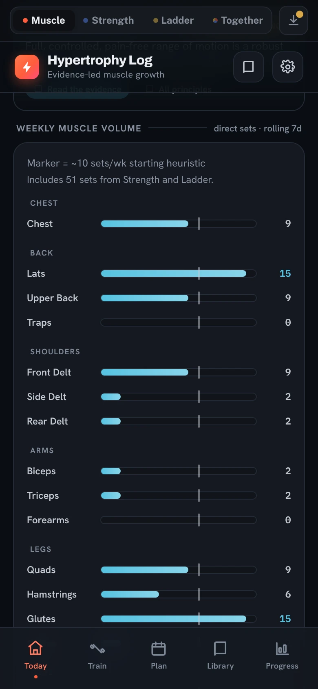 Hard sets per muscle, this week</td>
    <td align="center" valign="top" width="33%">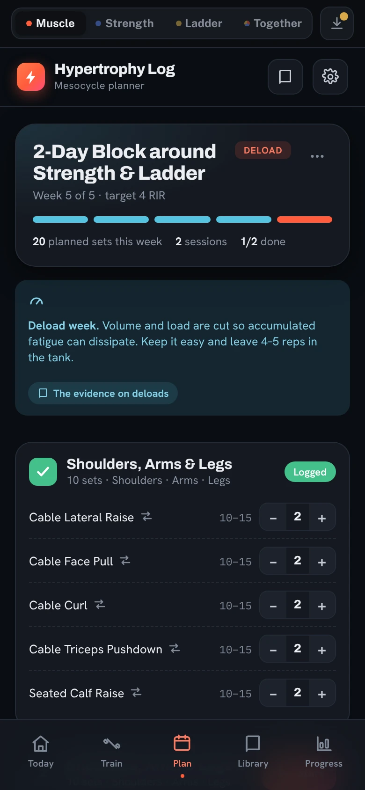 A block built around the other two</td>
    <td align="center" valign="top" width="33%">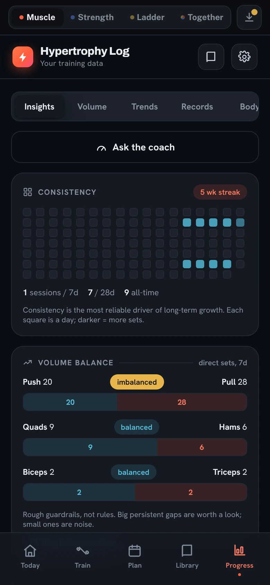 Progress</td>
  </tr>
</table>

**Strength.** Six areas, seven kinds of kit, about thirty exercises ranked for strength, and a swap for any of them. Three program styles (simple progression, four-week wave cycles, autoregulated top sets) built around whatever you picked, with rep-range progressions for dumbbells, machines and weighted bodyweight moves and harder-variation chains when there is no load at all. Estimated maxes from your RPE, rep-max tables, and calculators for your max, plates and warm-ups. A strength-specific evidence library.

<table>
  <tr>
    <td align="center" valign="top" width="33%">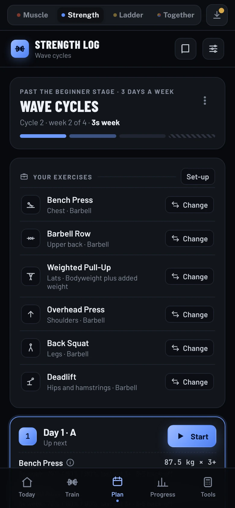 Wave cycles, built from your kit</td>
    <td align="center" valign="top" width="33%">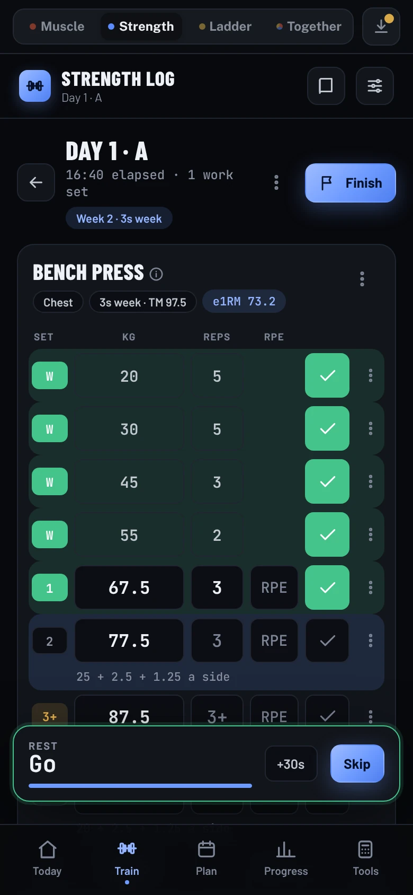 Warm-ups and plates worked out</td>
    <td align="center" valign="top" width="33%">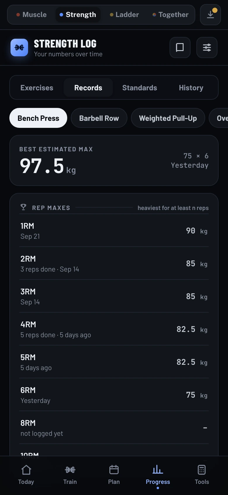 Records: estimated max and rep maxes</td>
  </tr>
</table>

**Ladder.** Choose a calisthenics goal, such as a first pull-up, a handstand, a muscle-up or a pistol squat, or create your own. The library groups pulling, pushing, legs, core, arms, skills and preparation. Related movements have their own paths: weighted pulling is separate from one-arm pulling, hip extension is separate from Nordic curls, and ring dips can train alongside false-grip and muscle-up work. Assisted movements, shorter levers and adjustable heights bridge larger jumps.

Record the reps or seconds you actually completed. Form is assumed clean; clear the box when a set misses the form standard. Setup such as band, lean or box height is not measured. Practice attempts remain in your log but do not certify readiness. A later exercise never substitutes for an exact earlier requirement, such as twelve pull-ups.

Repeat a step target cleanly on two training days, then check a controlled version of the next movement. These are coaching defaults, not research-proven guarantees that one skill leads to another. Change one demand gradually: reduce assistance or starting height where appropriate, or increase load, controlled range or leverage. Targets can also grow toward a higher goal or supporting standard, such as a thirty- or sixty-second handstand.

Each goal includes supporting strength, mobility, balance and technique where relevant. Missing qualities join the sessions, and completed qualities remain in a smaller maintenance rotation. Warm-ups come first, balance and power work come while fresh, and longer stretches come last. Brief balance practice can be frequent; demanding planche and lever work still needs recovery. With many goals, a session holds the strength work of three goals and up to two balance skills, at most seven exercises besides the wrist warm-up and a one-set maintenance check; the goals take turns, spread so a session mixes pulling, pushing and legs, and Today says which come next. With weekly sets matched, how they are spread over the days changes little, so each goal still comes round, just with a smaller share of the week each. Related easier exercises provide volume work without assuming that the previous catalog entry is a suitable regression. On the Goals tab, each goal folds to a summary of its progress, current step and what else it takes; tap it to see the whole path. One goal starts open, several start folded, and tapping a goal on Today opens it there.

Exercises that are in Muscle too (32 of them, such as pull-ups, chin-ups, dips, push-ups, rows, split squats and Nordics) share their sets: the ones you tick in Muscle count here as clean sets of that exercise, toward your best, your targets and your next rung, and Muscle starts a bodyweight one from your latest Ladder set when that is newer. Holds are left out, since Muscle logs reps. Weekly hard sets still count each set once, in the trainer you did it in. Every exercise has written instructions. Custom ladders and goals remain available. Existing workouts, exercise identities, open sets and backups are preserved; old records without form confirmation remain visible but need a current confirmation or check before they establish readiness. The evidence library separates general research findings from coaching choices. See [Ladder progression and evidence](ladder-progression.md) for the rules, sources and their limits.

<table>
  <tr>
    <td align="center" valign="top" width="33%">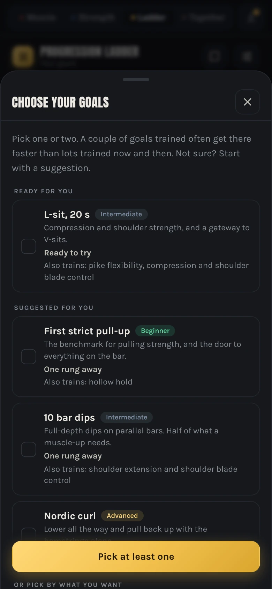 Choosing a goal</td>
    <td align="center" valign="top" width="33%">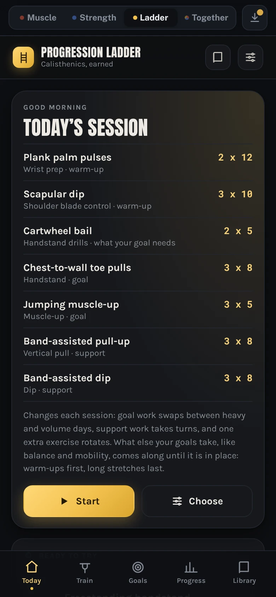 Today's session</td>
    <td align="center" valign="top" width="33%">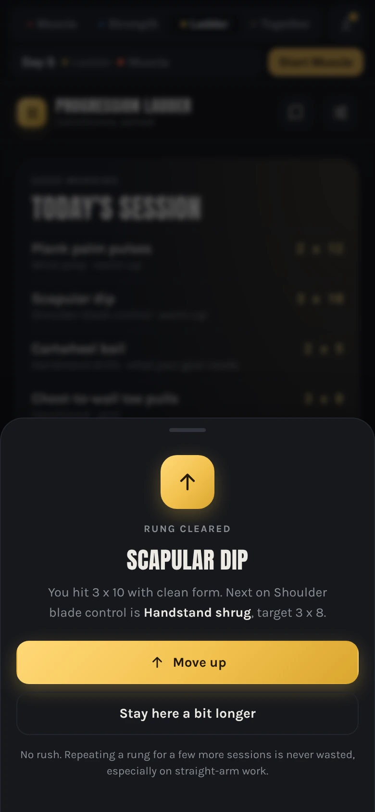 A rung cleared</td>
  </tr>
</table>

Every recommendation in all three links to the research behind it, with an honest note on how strong that evidence actually is.

  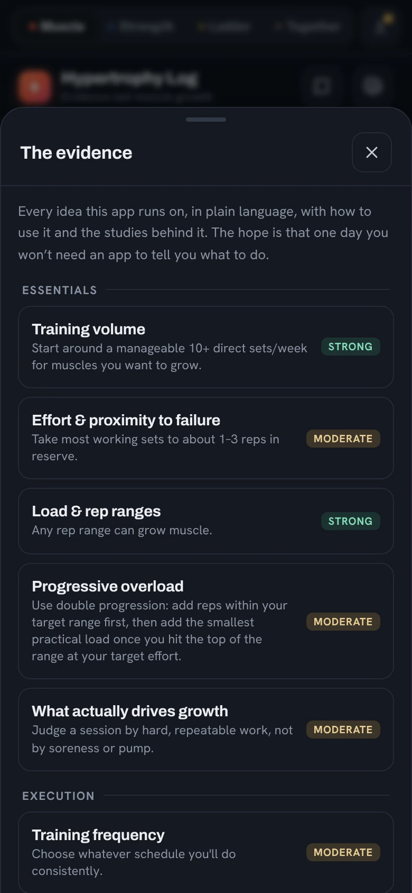 
  The evidence, and how strong it is

**Together.** The app opens here. Pick one, two or all three kinds of training and rank them under *What comes first*, then set your days (two to seven), session length, kit and experience. Together builds one program from that, and the trainers you picked appear as tabs. Rank sets the dose. First gets a building dose: in Strength each main lift once or twice a week, heavy; in Muscle about 10 hard sets a week for each muscle (8 if you are new, 12 if experienced); in Ladder three or four sessions a week. Second gets a moderate dose. Third gets a maintenance dose, much less work at the same effort about once a week, which studies find keeps strength and size for months. Together reads only data from the trainers: their exercise catalogues, your estimated maxes and working weights in Strength, your last sets in Muscle, and your Ladder goals and rungs. A Muscle block, a Strength program or Ladder's own sessions stay in their trainer for training that one thing alone; Together never moves them on, and every session it runs still adds to that trainer's history and numbers. Hard sets from every part count toward one weekly total per muscle, in full for the muscles an exercise mainly works and half for the ones that help (biceps in a row), the way recent analyses count them. Muscle tops up only what Strength, Ladder and its own exercises for other muscles leave, with isolation work on heavy days. When Muscle's days are full it spreads the same weekly sets over another of your training days before any muscle is trained less often; anything that still falls short of its target is marked. Squats and deadlifts go on different days when they can. A block is four weeks of rising effort (Strength's heavy sets from 5 reps at RPE 7 to 3 at RPE 9, Muscle from 3 reps in reserve to 1) and then a lighter week; after it, Together builds the next block from your new numbers. A day that would run over your time gives way from the last in your order. You can tap any section on or off a day, and Together refills the days to match. Every block opens for you to customize before it starts, and *Customize this block* changes it any time: for each muscle group in Muscle, *More* (half as much weekly work again, for the one or two groups you most want to grow, and first to get room), *Normal*, *Less* (the dose that keeps what you have, about a third of the work) or *Skip* (left to the rest of your week), each spelled out in sets, with every muscle's weekly total and the sources behind them; within a group, each muscle can be tapped off on its own (traps in Back, say), so it gets no exercises of its own and none aimed at it for other muscles, only what other work gives it; one or more exercises for each muscle, from a library page with every exercise in the Muscle library that works it (141 exercises, each with how-to steps: 10 to 20 for most muscles, such as 15 for the upper back and 20 for the lats) (search, exercises that need other equipment, or *Let Together pick*, which prefers exercises you have logged, so their weights carry on, and otherwise varies them by day); several picks take turns on the muscle's days in the order picked, and each shows the days it lands on, where you can also make your own exercise, which joins the Muscle library; the lift for each strength area, or leave an area out; and your Ladder goals, each with the rung you are on and how far along you are, which you can remove (with Undo; rungs and history stay in Ladder) or add to with *Add a goal*, which opens Ladder's goal chooser and comes back to the block when you close it or finish placing the new goal (a placement test you start keeps you in Ladder until it's done). Because goals share Ladder's sessions, fewer at once move faster, so the block recommends how many: two when Ladder builds on two or more days a week, one otherwise. It shows the sets a week each goal gets now, from Ladder's own plan for a week of your block (its own movement plus its share of what it rests on), and what each would get kept to the recommendation. With more goals than that, it keeps the ones nearest done, never two straight-arm skills like the planche and a lever together (they load the elbows and the biceps tendon the same way, and tendons adapt more slowly than muscle), and pauses the rest in one tap, with Undo; paused goals keep their rungs and history. With fewer, it suggests goals a few rungs from where you are, on movements your goals don't train yet, with at most one straight-arm and one balance skill, and says when Strength already trains that movement; *Add* sets the goal and opens Ladder to place it. With no Ladder goals at all, the main page shows the same suggestions. The rules are coaching defaults drawn from the studies listed under *Why fewer goals move faster*. Changes mid-block refill the days and keep your week, and *Start a new block* begins again at week 1, Day 1, on a fresh week. Under the program, the block's weeks can be moved: back a week, start this week again, or skip ahead to the next (after the lighter week, a new block); each starts the week at Day 1. A new block and a week moved work at any time, even mid-day: today's day ends there, and a session still going stays open in its trainer. *End the day here* ends the day whatever is left; with a part still going it asks what to do with that session: end it and keep the sets you logged, leave it open to finish later (it still counts for the day once you finish it), or end it without saving (which can be taken back in that trainer). A day ended with nothing done stays next up. Missed time is usually better met by starting the week again, since a week or two off costs little muscle or strength. *Skip this day* marks the next day skipped and moves on, and a day closed this time round shows the parts it had then, ticked or crossed out, whatever the plan now puts on it. Skipping a part or a day, ending a day early, a week moved, a new block, changes to the block, the days or the set-up, and stopping Together can each be undone, from the toast or the *Undo* line at the top, until you next start or finish a day. Each day runs in your order. Muscle drops an exercise you already did earlier that day and trims sets for muscles that already got hard sets, compounds first, and it can put them back. In the suggested order, Ladder support work is left out when Strength or Muscle trains the same thing that day; in your own order, only when a section ahead of it does, so with Ladder ahead of Strength its support work stays and a note warns that the heavy lift may feel harder. Goal work always stays. Fatigue carries over between days: hard sets from the last three days still count against a muscle (yesterday in full, then half, then a quarter). A muscle carrying about six or more gets one to three fewer Muscle sets and no Ladder support work, and Strength shows a heads-up but keeps its prescription. While a day is running, a strip above the bottom of each trainer's tab shows the day's parts and starts the next one; on Together itself the day card at the top does that. Each trainer in your program says on its Today what it is for.

<table>
  <tr>
    <td align="center" valign="top" width="50%">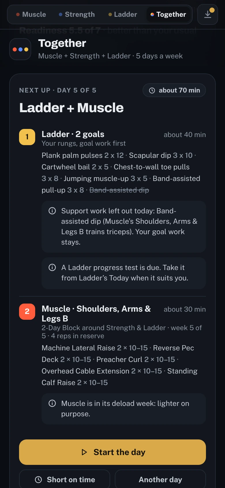 Today's parts, in order</td>
    <td align="center" valign="top" width="50%">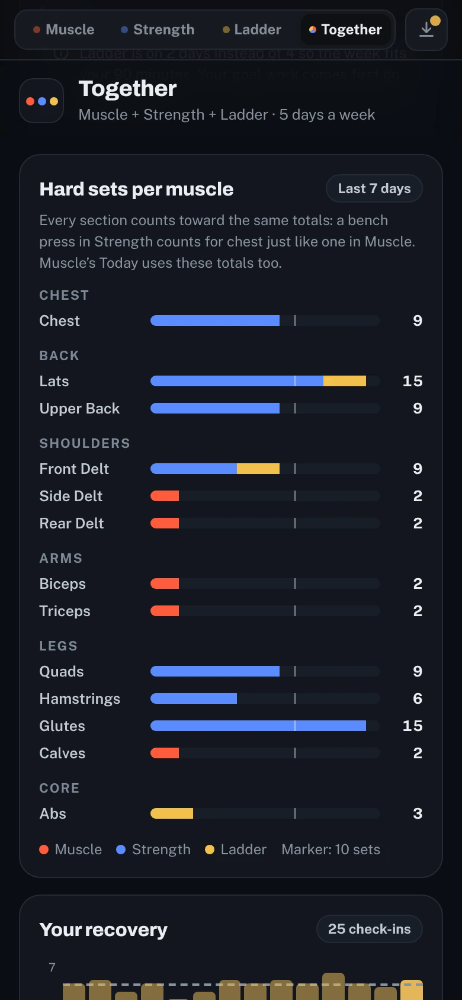 Every section's hard sets, counted once</td>
  </tr>
</table>

**The daily check-in.** Together asks, before you start a day, how you slept and feel (sleep, energy, stress and mood, each 1 to 7, the Hooper wellness scales), which muscles are sore (0 to 10, for the muscles trained lately or in today's plan) and whether a joint hurts (0 to 10, in eight joints). It takes about thirty seconds, can be skipped, and is saved on your phone with the rest of Together. Three things come from it. *Readiness* is the four wellness answers averaged and set against your own last 28 days, because a score only means something next to your usual (until there are seven days to compare with, below the middle of the scale counts as low). A low day takes a set off each muscle in Muscle and the support work out of Ladder, and Strength keeps its plan with a note to stop a rep or two short; a very low day suggests resting, and the day just waits. *Soreness you report* and *a sore joint* hold back the muscles involved the same way tired muscles already are: a joint at 3 or more holds back the muscles that load it, and at 6 or more (or 4 or more on three check-ins running) it holds them back hard, with a note to swap or skip what loads it and to see someone qualified if the pain lingers. *Your recovery* is the learning part: each check-in keeps the sets that were still weighing on each muscle next to the soreness you reported, and from those pairs the app works out how many carried sets it takes before that muscle feels about 4 out of 10 sore. That number replaces the standard 6, muscle by muscle. It starts at 6, is pulled toward your readings slowly (a muscle needs three before it moves at all, recent readings count more, and the estimate is shrunk toward your overall rate), and stays between 3 and 12, so a few odd days can't swing it. In simulation, a muscle that really is sore at 4 carried sets was found within about ten check-ins, and one with no real sensitivity stayed near 6. The Your recovery card shows the readiness chart and each muscle's number with how much it rests on. Muscle takes what the check-in says about how you feel, so it doesn't ask again at the start of a session. Honest limits: the wellness scales are well supported (a systematic review found short subjective measures follow training load and fatigue more reliably than most objective ones), but mostly in endurance and team-sport athletes; soreness tells you about recovery, not growth; and the per-muscle number is this app's own estimate that no trial has tested. It adjusts the day, not the week: the layout of your week doesn't change. The sources are listed on the card. Finishing a part of the day starts the next part straight away, so the day runs as one session. That doesn't happen after a part you ended early, or when the next part's trainer already has a session going; then you come back to Together. It also covers the awkward cases: a section that isn't set up yet, a plan with more days than your week, days that run over your time, back-to-back heavy days, a session thrown away or ended early, a section already busy, and a day left open overnight.

<table>
  <tr>
    <td align="center" valign="top" width="50%">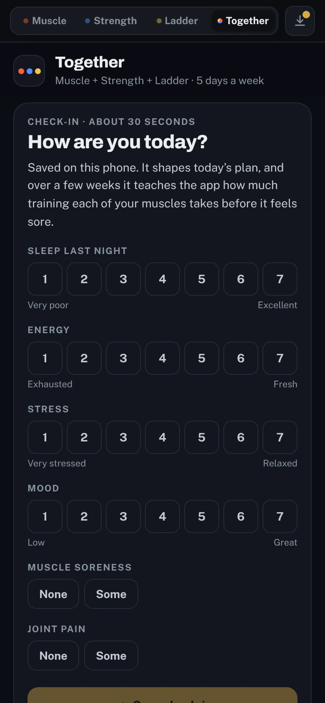 The thirty-second check-in</td>
    <td align="center" valign="top" width="50%">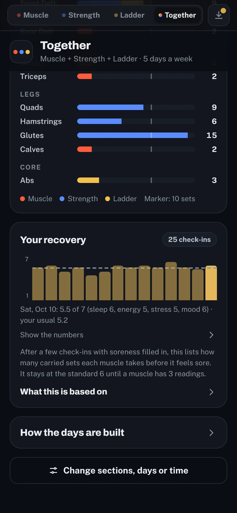 Your recovery</td>
  </tr>
</table>

## Accessibility

Pinch zoom works, but double-tap zoom is off so a quick second tap (on +30s, say) stays a tap. Text meets the 4.5:1 contrast standard in both themes (checked with axe-core on every tab, the main sheets and a live session). Sheets are real dialogs: a screen reader announces them by name, Escape closes them, the page behind can't be reached while one is open, and focus goes back to where you were. The four section tabs work with the arrow keys, Home and End. Icon buttons and set fields have names (for example "Set 2 weight"). Each exercise drawing is labelled with what it shows and the muscles it works, and with reduced motion turned on it shows the first and last positions side by side instead of moving. On iPhone, fields are kept at 16px so the page doesn't jump when you tap one.

The light theme. It follows your phone&rsquo;s setting unless you pick one.

<table>
  <tr>
    <td align="center" valign="top" width="25%">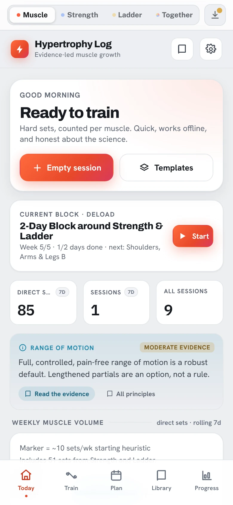 Muscle</td>
    <td align="center" valign="top" width="25%">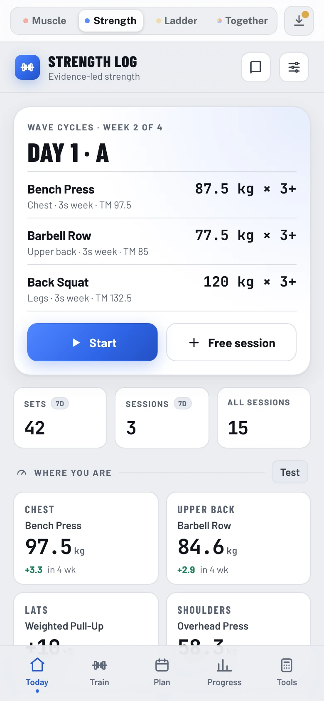 Strength</td>
    <td align="center" valign="top" width="25%">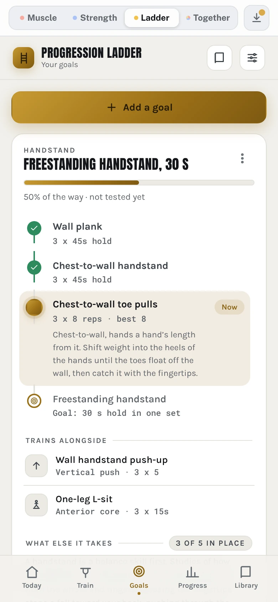 Ladder</td>
    <td align="center" valign="top" width="25%">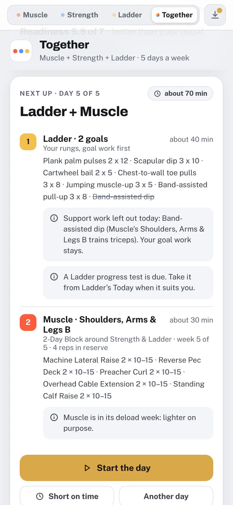 Together</td>
  </tr>
</table>

## Running it

[Open Milo](https://gwilltsherman-byte.github.io/milovancroton/) in your browser. That is the full app. You can use the same link on your phone and computer.

For a local copy or your own hosted copy, follow [RUNNING.md](../RUNNING.md). The app uses relative paths, so it can run in a subfolder.

## Adding it to your phone

Open the link in Safari on iPhone or Chrome on Android. Hit Share, then Add to Home Screen. It opens full screen and lives with your other apps. Load it once with signal and it runs offline from then on. On Android, press and hold the icon for shortcuts straight to Muscle, Strength, Ladder or Together; `index.html?m=str` (or `lift`, `cal`, `mix`) does the same from any link.

## Your data

Local storage, in whatever browser you use. No analytics, no login, nothing leaves the phone. The catch is there is no sync between devices, so back up now and then and restore after you switch phones. The arrow at the top makes one backup of all three sections, as a copy or a file; it shows a small dot once you have sessions and a fortnight has passed without a backup, and says when your last one was. A restore can be undone from the same sheet, one step back, for a month.

The app keeps your data safe in a few other ways. If the browser refuses a save, it tells you, once, instead of failing quietly. If a saved copy can't be read, that copy is kept aside (and goes into your next backup) before anything replaces it. A restore that doesn't fit puts everything back as it was. Anything waiting to be saved is written the moment the app is closed or sent to the background, and once you have sessions the browser is asked to keep the data rather than clear it when space runs short.

## Not medical advice

These are training logs. If a joint hurts or you feel off, stop and see someone qualified.

## Under the hood

`index.html` loads the trainers from `app.js` and backup checks from `security.js`. The app uses plain JavaScript without a framework. `sw.js` handles offline caching, and `manifest.webmanifest` supplies installation details. The PNGs provide the home-screen icons. `docs/screenshots` holds the pictures in this guide; the app never loads them.

## License

MIT. See [LICENSE](../LICENSE).

