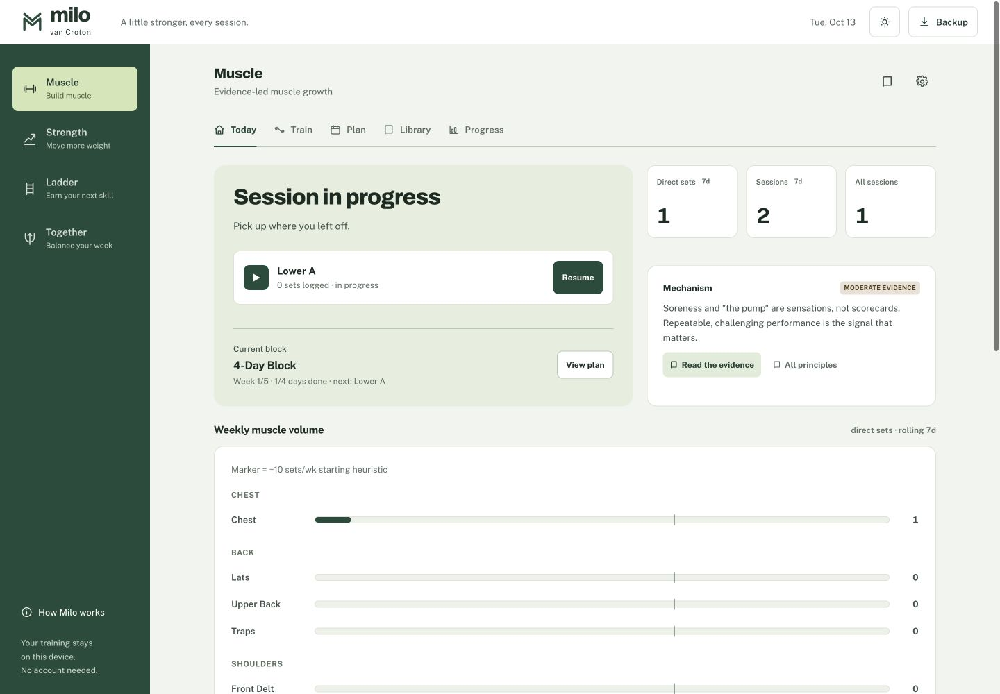

# Training studio redesign

Milo now has one working interface across Muscle, Strength, Ladder and Together. The evergreen navigation and mineral surfaces give training plans a calm, consistent frame. Public Sans handles controls and longer reading; Archivo makes headings easy to scan. The design is a replacement for the previous visual system, with the existing training engines, routes, local data and backup formats retained.

The main outcomes are finding the next workout quickly, logging sets comfortably on a phone, understanding progress from real saved training, and moving between trainers without relearning the interface. A desktop rail separates the four trainers from each trainer’s routes. Phones use a top trainer switcher and bottom route navigation. Help is available on demand rather than opening over the first task.

Apple, Stripe and Linear were inspected live during development. The useful principles were clear hierarchy and spacing, purposeful color, and consistent working navigation. Milo’s identity follows its own training content.

## Preview and run

Serve the repository with `python3 -m http.server 8000`, then open `http://localhost:8000`. No build or package installation is required. Use a separate local origin when testing so production workout data is unaffected. All screenshots below show local test data, not a supplied user workout record.

[Phone overview](screenshots/training-studio-mobile.jpg) · [Phone set logging](screenshots/training-studio-session.jpg)

## Implementation

- `shell.css` owns the shared frame; `trainer.css` is loaded after the original styles inside all four shadow roots and owns the replacement design tokens and components.
- `app.js` adds the real-history seven-day view, direct plan creation, global theme synchronization, keyboard operation and the shared guide. State schemas and training calculations are unchanged.
- Both new stylesheets participate in the offline shell and content fingerprint. After changing application assets, run `node tools/update-integrity.cjs`.
- [PRODUCT.md](../PRODUCT.md) records product context. [DESIGN.md](../DESIGN.md) and `.impeccable/design.json` record final rules and component examples.

## Verification

Completed on 2026-10-13 in the local in-app browser:

| Check | Result |
| --- | --- |
| Node regression tests | 37 passed |
| Redesign browser suite | 73 passed |
| Existing security browser suite | 17 passed |
| Existing Ladder browser suite | 20 passed |
| Script syntax and generated integrity | Passed |
| Desktop, tablet and phone widths | 1440, 768, 390 and 360 px; no document overflow on observed screens |

Run the Node checks with `node --test tests/*.test.cjs` and `node tools/update-integrity.cjs --check`. With the server running, open `tests/redesign-browser.html`, `tests/browser.html` and `tests/ladder-browser.html`. Run them sequentially on a separate local origin with other Milo tabs closed. The redesign suite snapshots and restores Milo storage; its test fixture is explicitly identified.

Manual workflows covered Muscle plan generation, starting a workout, entering a set, rest timer, finishing and saving; Strength setup; Ladder goal placement; Together scheduling and daily check-in; global theme changes; guide and backup controls. The regression suites additionally exercise all 15 trainer routes, keyboard session history, actual calendar counts, invalid backup rejection, per-set Ladder assistance, reload persistence and CSP protection.

One combined critique, accessibility and visual review identified hidden state labels, stale live theme settings, modified keyboard shortcuts, a clipped three-digit rest field, completed-state contrast, system-dark logo visibility, long explanatory lines and a tall desktop check-in. A coordinated correction pass addressed those findings and the affected screens were captured again. Secondary rail text measured as green-tinted text was retained; inactive original glow rules are overridden; the deload marker retains a meaningful distinct pattern.

Physical phone installation, standalone Safari behavior, screen-reader narration, actual device vibration/wake lock and a real disconnected service-worker session were not exercised. Existing service-worker unit checks passed. These are verification limits, not claims of completed device testing.
